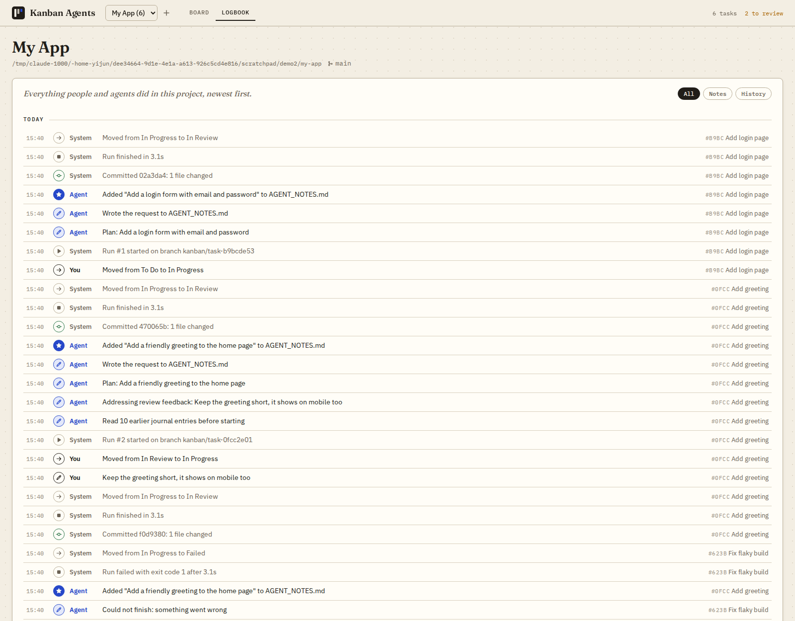
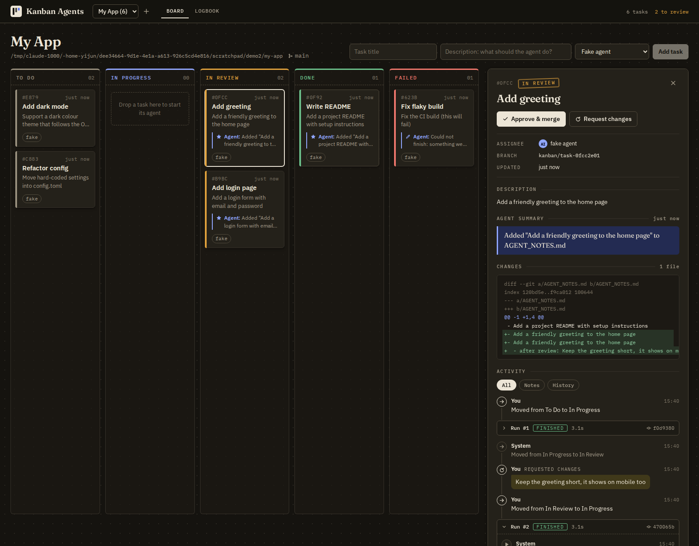
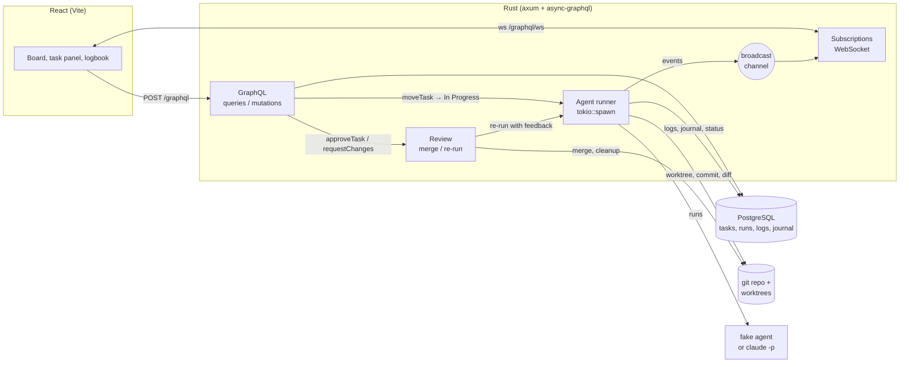
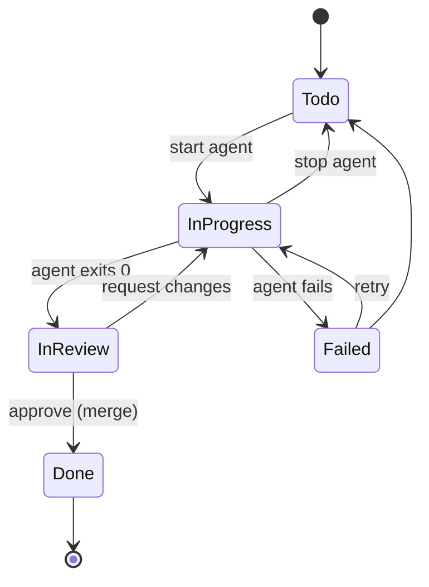

# Kanban Agents

A Kanban board where the "team members" are AI coding agents. You write a task and drag it to
**In Progress**. An agent picks it up, works in its own git worktree, streams its output to the
browser live, keeps a **journal** of what it did and why, and commits its changes. The card then
moves to **In Review**, where you read the agent's summary and diff, and either **approve** it
(the branch is merged into `main`) or **request changes** (the agent runs again with your feedback).


> **Status:** everything works end to end with a scripted *fake* agent. A real agent
> (Claude Code, headless) is built in and tested against a stand-in for the CLI; it has not yet
> been run against the real service. See [Real agent](#real-agent-claude-code).

## Features

- **Board rules on the server.** Cards follow a state machine, so you can't drag from To Do
  straight to Done, for example. The rule lives in one place (`TaskStatus::can_move_to`), and
  the database row is locked during a move so concurrent moves can't race.
- **Background agents you can stop.** Moving a card to In Progress starts an agent in a Tokio
  task; moving it back to To Do stops it. A failed task can be retried.
- **Live updates over GraphQL subscriptions.** Agent output, journal entries and card moves are
  pushed to every open browser over WebSocket. No polling.
- **One git worktree per task.** Each task gets its own branch (`kanban/task-<id>`) and folder,
  so agents can run in parallel without touching each other's files or your `main` checkout.
- **A journal for every task.** An append-only record of who (you, the agent, the system) did
  what, and when. Agents write to it by printing `JOURNAL:` lines, and end with a
  `JOURNAL: SUMMARY:`. The database itself refuses edits and deletes. A re-run agent is given
  the earlier journal, so it knows what was already tried.
- **Review flow.** *Approve & merge* merges the task's branch into the project's branch with a
  merge commit that carries the task's journal, then deletes the worktree and branch. A merge
  conflict is undone and the task stays in review. *Request changes* sends your feedback to the
  agent and runs it again.
- **Logbook.** One page with the whole project's journal, newest first.
- **Failures are visible.** A non-zero exit, a git error or a backend restart moves the card to
  Failed, with the reason in the journal, instead of leaving it stuck in In Progress.

| The logbook | Dark mode |
|---|---|
|  |  |

## Architecture



### Task lifecycle



### What one run writes in the journal

```
HUMAN   STATUS        Moved from To Do to In Progress
SYSTEM  RUN_STARTED   Run #1 started on branch kanban/task-6ab05444
AGENT   NOTE          Plan: add a friendly greeting to the home page
AGENT   NOTE          Wrote the request to AGENT_NOTES.md
AGENT   SUMMARY       Added "Add a friendly greeting…" to AGENT_NOTES.md
SYSTEM  COMMIT        Committed f94906d: 1 file changed
SYSTEM  RUN_FINISHED  Run finished in 3.3s
SYSTEM  STATUS        Moved from In Progress to In Review
```

## Tech stack

| Layer | Choice |
|---|---|
| API | GraphQL: [async-graphql](https://github.com/async-graphql/async-graphql) on [axum](https://github.com/tokio-rs/axum) |
| Backend | Rust 2024, Tokio, [sqlx](https://github.com/launchbadge/sqlx) (migrations run on startup) |
| Database | PostgreSQL 16 (Docker Compose) |
| Frontend | React 19, TypeScript, Vite, [urql](https://github.com/urql-graphql/urql), [dnd-kit](https://dndkit.com/) |
| Typed GraphQL | [graphql-codegen](https://the-guild.dev/graphql/codegen) client preset |
| Tests | `cargo test` (unit + `#[sqlx::test]` integration), Playwright (e2e) |

## GraphQL API

GraphiQL is served at `http://localhost:3000/graphql`.

```graphql
query {
  agents { kind label ready reason }               # which agents can run on this machine
  projects {
    name defaultBranch
    journal(limit: 20) { actor kind message task { title } }   # the logbook
    tasks {
      title status branch mergeCommit diff
      headline { actor message }                   # the card's newest journal line
      journal { actor kind message details }       # the task's whole journal
      logs { seq content }                         # raw output of the latest run
    }
  }
}

mutation { createProject(name: "My app", repoPath: "/path/to/repo") { id defaultBranch } }
mutation { createTask(projectId: "…", title: "…", prompt: "…", agent: FAKE) { id } }
mutation { moveTask(id: "…", status: IN_PROGRESS) { status } }   # starts the agent
mutation { addJournalNote(taskId: "…", message: "…") { id } }
mutation { approveTask(id: "…") { status mergeCommit } }         # merge + clean up
mutation { requestChanges(id: "…", feedback: "…") { status } }   # re-run with feedback

subscription { taskLogs(taskId: "…") { seq content } }            # live agent output
subscription { journalAdded(taskId: "…") { actor kind message } } # live journal
subscription { taskUpdated(projectId: "…") { id status } }       # live board changes
```

## Running locally

Requires Docker, Rust, Node 24+, `sqlx-cli` (`cargo install sqlx-cli --no-default-features --features postgres`).

```bash
docker compose up -d                       # Postgres on :5432

cd backend
cp .env.example .env
cargo run                                  # API on :3000, applies migrations

cd ../web
npm install
npm run dev                                # UI on :5173
```

Open http://localhost:5173 and create a project: give it a name and the path of any local git
repository. Then add tasks and drag them to **In Progress**. Put the word `fail` in a
description to see the failure path.

### Real agent (Claude Code)

The board can run [Claude Code](https://claude.com/claude-code) headless instead of the fake agent.

1. Install the `claude` CLI.
2. Put your own API key in `backend/.env` (git ignores this file):
   `KANBAN_ANTHROPIC_API_KEY=sk-ant-…`
3. Restart the backend, then pick **Claude Code** in the agent menu when you add a task.

How it is kept contained:

- The key has its own variable name, so a key exported in your shell for something else is
  never picked up. Without it, the agent refuses to start.
- The CLI gets its own config directory (`~/.config/kanban-agents/claude`), so it never uses a
  login saved in `~/.claude`.
- It runs with `--permission-mode acceptEdits`: it can edit files in its worktree but cannot
  run shell commands. Each run is capped by `--max-budget-usd` (default $1.00).

## Tests

```bash
cd backend && cargo test     # 36 tests
cd web && npm run test:e2e   # 10 Playwright tests in a real browser
```

- **Unit tests** check every from/to pair of the state machine, the git helpers (worktree,
  commit, diff, merge, conflict, cleanup) against a temporary repo, journal-line parsing, and
  the conversion of Claude's JSON output into readable lines.
- **Integration tests** run real GraphQL operations against the schema. `#[sqlx::test]` gives
  each test its own freshly migrated database. They cover a full agent run and its journal,
  failure and retry, stopping an agent, recovery after a restart, approving (merge, cleanup,
  conflict), requesting changes, the append-only rule, the subscription streams, and the
  Claude agent using a stand-in script for the CLI.
- **End-to-end tests** start their own backend (port 3917, database `kanban_e2e`) and Vite
  (port 5917). They drive the UI with a real mouse: drag a card, watch live output, approve and
  check the real repository was merged, request changes, stop and retry agents, add notes, use
  the logbook, and create a project.

## Project layout

```
backend/
  migrations/          SQL migrations (sqlx)
  src/
    main.rs            axum server, GraphiQL, WebSocket route
    graphql.rs         schema: queries, mutations, subscriptions (+ integration tests)
    domain.rs          Task / Project / JournalEntry types, status state machine
    tasks.rs           transition(): move a card and journal it, in one transaction
    journal.rs         journal entries: insert, record + broadcast, JOURNAL: line parsing
    agent.rs           runs an agent, streams logs, commits work; start / stop / recover
    claude.rs          the Claude Code runner: command, prompt, output parsing
    review.rs          approve (merge + clean up) and request changes (re-run)
    git.rs             worktree / commit / diff / merge helpers
    events.rs          broadcast channel for subscriptions
web/
  src/App.tsx          shell: project, view (board or logbook), selected task
  src/components/      Board, Column, TaskCard, TaskPanel, ReviewActions, Journal,
                       Logbook, ProjectSwitcher, NewTaskForm, Icon
  src/journal.ts       journal types, labels, filters
  src/useJournal.ts    saved + live journal entries for one task
  src/useRefetchOnTick.ts  refetch queries after every live event
  src/index.css        the design ("The Logbook"): tokens, light and dark
  e2e/                 Playwright tests
docs/
  GUIDE.md             study guide: how the journal, review flow and agents were built
```

## Roadmap

- [x] Board, GraphQL API, drag and drop
- [x] Background agent runner with live logs (subscriptions)
- [x] Per-task git worktrees, auto-commit, diff review
- [x] Unit, integration and end-to-end tests
- [x] Journal: append-only, written by agents, read by re-runs
- [x] Review flow: approve → merge and clean up; request changes → re-run with feedback
- [x] Real coding agent (Claude Code, headless) — built, tested with a stand-in CLI
- [ ] Run the Claude agent against the real service and tune its prompt
- [ ] Agent plans as a live checklist; let the agent run the project's tests
